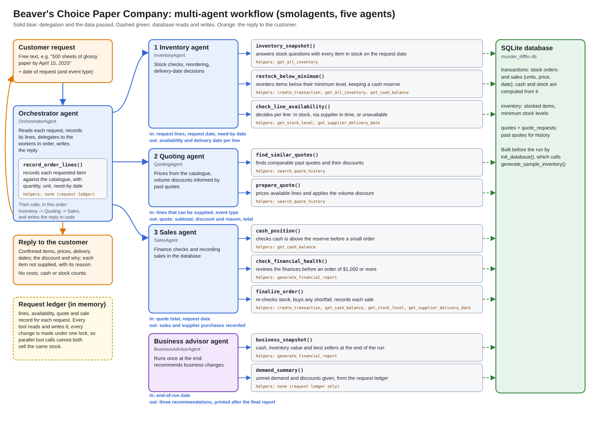

# Beaver's Choice Paper Company: Multi-Agent Sales System

Author: Ty

A five-agent system, built with **smolagents**, that reads customer requests for paper supplies, checks inventory and supplier lead times, prices quotes with volume discounts informed by past quotes, records sales in the company's SQLite database, and explains every decision to the customer.

## Contents of this repository

| File | What it is |
|---|---|
| `project_starter.py` | The complete implementation: the starter's database helpers, the five agents, their tools, and the evaluation run. The only Python file. |
| `agent_workflow_diagram.png` | The agent workflow diagram: agents, their tools, the starter helper functions each tool uses, and the data passed between them. |
| `README.md` | This report. |
| `test_results.csv` | The evaluation output: one row per request in `quote_requests_sample.csv`. |
| `quote_requests_sample.csv`, `quote_requests.csv`, `quotes.csv` | The course data files, unchanged, so the run can be reproduced. |
| `requirements.txt` | The course's requirements file with `smolagents` added, pinned to the version used. |

### How to run

```bash
python3.12 -m venv .venv && source .venv/bin/activate
pip install -r requirements.txt
echo 'UDACITY_OPENAI_API_KEY=your_key_here' > .env
python project_starter.py
```

The run initialises `munder_difflin.db`, processes all 20 requests in date order, prints each agent's step, the reply and the updated cash and inventory value, prints the final financial report and the business advisor's recommendations, and writes `test_results.csv`. Requests go to `gpt-4o-mini` through the Vocareum endpoint (`https://openai.vocareum.com/v1`), with the key read from `UDACITY_OPENAI_API_KEY`.

## 1. The agent workflow diagram, explained



The system has **5 agents**, the project's maximum: one orchestrator, three workers that each own one stage of an order, and a business advisor.

| Agent | Responsibility | Its tools |
|---|---|---|
| `OrchestratorAgent` | Reads the customer's free-text message and calls `record_order_lines` once, mapping each requested item to an exact catalogue name (or `NOT_CARRIED`) with its quantity, unit and the need-by date. It then delegates to the workers in a fixed order and writes the reply. | `record_order_lines` |
| `InventoryAgent` | Restocks items that have fallen below their minimum level, then decides for each line whether it can be delivered by the customer's date: from stock, through a supplier delivery that arrives in time, or not at all. Answers stock questions from an inventory snapshot. | `inventory_snapshot`, `restock_below_minimum`, `check_line_availability` |
| `QuotingAgent` | Finds comparable past quotes, then prices the lines that can be supplied at catalogue prices with a volume discount. | `find_similar_quotes`, `prepare_quote` |
| `SalesAgent` | Checks the company's finances (a full financial report before orders of $1,000.00 or more, the cash position otherwise), then records the sale and any supplier purchase it needs. | `cash_position`, `check_financial_health`, `finalize_order` |
| `BusinessAdvisorAgent` | Runs once, after the last request: reviews the financial position and the unmet demand, and recommends changes to the business. | `business_snapshot`, `demand_summary` |

No tool belongs to more than one agent, so the responsibilities do not overlap: only the inventory agent decides availability, only the quoting agent sets prices, only the sales agent writes sales.

### How one request flows through the agents

1. The orchestrator receives the request text and its date, and records the lines.
2. **Inventory**: restock low items; check each line against stock on the request date and, if short, against the supplier's delivery date for the shortfall (`get_supplier_delivery_date`). A line is available only if it can reach the customer by their date.
3. **Quoting** (only if something is available): search past quotes, price the available lines, apply the discount.
4. **Sales**: finance check, then record each sale, buying the shortfall from the supplier first. Stock is re-checked here, because another order may have taken it since step 2.
5. The orchestrator composes the reply from what was recorded: confirmed lines with prices and delivery dates, the discount and why, and every line not supplied with its reason.

### Why this architecture

- **Orchestrator and workers, not peers.** The order of the stages never changes (you cannot price what you have not checked, or sell what you have not priced), so a central orchestrator calling the workers in a fixed order is simpler and easier to verify than agents negotiating among themselves.
- **The model reads; code decides.** Language models are used where language is the problem: reading a free-text request and mapping "heavy cardstock (white)" to `Cardstock`. Stock checks, delivery dates, prices and sales are decided by code inside the tools, so the same request always gets the same outcome and every decision can be explained. If a worker's model skips a tool call, the orchestrator runs that tool itself, and if the model's choice contradicts an item the customer's wording plainly names ("heavy cardstock (white)" marked not carried although we sell `Cardstock`, or "colorful poster paper" mapped to `Colored paper` rather than `Poster paper`), the intake tool records the plainly named item instead.
- **One owner per decision.** Each tool belongs to exactly one agent, and each agent receives only its own tools, so no agent can take an action outside its role.
- **Safe under parallel tool calls.** smolagents runs the tool calls of one model reply in parallel threads. Every check-then-change happens under one lock, so two calls can never both sell the last of an item.
- **Replies written by code.** The reply is assembled from the recorded decisions, so it can include every item, price, date and reason, and cannot include costs, cash figures, stock counts or error messages.
- **The fifth agent.** The five-agent limit left one slot after the orchestrator and the three workers; it is used for the business advisor (a suggested stand-out), because it analyses the whole run rather than one request.

## 2. Tools and the starter's helper functions

| Tool | Agent | Starter helper functions it uses |
|---|---|---|
| `record_order_lines` | `OrchestratorAgent` | none (works on the request ledger) |
| `inventory_snapshot` | `InventoryAgent` | `get_all_inventory` |
| `restock_below_minimum` | `InventoryAgent` | `create_transaction`, `get_all_inventory`, `get_cash_balance` |
| `check_line_availability` | `InventoryAgent` | `get_stock_level`, `get_supplier_delivery_date` |
| `find_similar_quotes` | `QuotingAgent` | `search_quote_history` |
| `prepare_quote` | `QuotingAgent` | `search_quote_history` |
| `cash_position` | `SalesAgent` | `get_cash_balance` |
| `check_financial_health` | `SalesAgent` | `generate_financial_report` |
| `finalize_order` | `SalesAgent` | `create_transaction`, `get_cash_balance`, `get_stock_level`, `get_supplier_delivery_date` |
| `business_snapshot` | `BusinessAdvisorAgent` | `generate_financial_report` |
| `demand_summary` | `BusinessAdvisorAgent` | none (works on the request ledger) |

All seven helper functions the rubric lists are used inside tools: `create_transaction`, `generate_financial_report`, `get_all_inventory`, `get_cash_balance`, `get_stock_level`, `get_supplier_delivery_date`, `search_quote_history`. `init_database` (which calls `generate_sample_inventory`) builds the database at the start of the run, so every helper in the starter is used. `get_all_inventory`, `get_cash_balance` and `generate_financial_report` each sit in a tool owned by an agent.

## 3. Business rules

- **Units.** Paper is sold by the sheet; a ream is 500 sheets. A quantity given in packs or boxes, whose size we do not know, is declined with a request for the number of single items.
- **Availability.** Items in stock are delivered 1 day after the request; items bought from the supplier arrive on the supplier's date and reach the customer 1 day later. A line whose delivery date would be after the customer's date is declined, with both dates in the reason.
- **Volume discounts.** 5% on orders of $50.00 or more; 10% on orders of $200.00 or more; 15% on orders of $1,000.00 or more. If past quotes for orders of the same size gave a larger discount, it is matched, up to 15%.
- **Purchasing.** Supplier purchases are recorded at 60% of the catalogue price (an assumption: the starter gives one price per item). With discounts capped at 15%, every sale is above the purchase price.
- **Cash reserve.** No purchase may take cash below $5,000.00.
- **Reordering.** Before each request, any stocked item below its minimum level is restocked to 2x that level, cash reserve permitting.
- **Booking.** Sales and purchases are recorded on the request date; delivery dates are promises made to the customer.

## 4. Evaluation results

All **20 requests** in `quote_requests_sample.csv` were processed; `test_results.csv` holds one row per request, with an `outcome` column added to the starter's columns.

| Outcome | Requests |
|---|---|
| fulfilled | 4 |
| partially fulfilled | 12 |
| not fulfilled | 4 |

- **Orders fulfilled:** 16 of 20 requests led to a sale (4 in full, 12 in part).
- **Cash balance:** changed on 18 of 20 requests, from $45,059.70 before the first request to $46,464.53 after the last. Some changes come from sales, others from supplier purchases and restocking, so this count and the sales count differ.
- **Unfulfilled:** 4 requests could not be fulfilled at all, and 12 were fulfilled in part. Every declined line carries its reason in the reply:
  - item not carried: 16 lines
  - supplier could not deliver by the customer's date: 13 lines
  - quantity given in a unit we cannot price: 1 line
- **Pricing:** 16 quotes were issued, totalling $3,385.28 after discounts. Discounts given: 5% on 7 orders, 10% on 6 orders, 15% on 1 order; 3 orders had the discount raised to match comparable past quotes.
- **Supply:** 30 lines were confirmed, 19 of them through supplier purchases made because stock alone could not cover them.

| Request | Date | Outcome | Cash change |
|---|---|---|---|
| 1 | 2025-04-01 | fulfilled | +$61.75 |
| 2 | 2025-04-03 | partially fulfilled | +$49.00 |
| 3 | 2025-04-04 | partially fulfilled | +$158.16 |
| 4 | 2025-04-05 | fulfilled | +$17.78 |
| 5 | 2025-04-05 | partially fulfilled | +$54.00 |
| 6 | 2025-04-06 | partially fulfilled | +$28.50 |
| 7 | 2025-04-07 | partially fulfilled | +$373.44 |
| 8 | 2025-04-07 | partially fulfilled | +$156.00 |
| 9 | 2025-04-07 | partially fulfilled | -$25.28 |
| 13 | 2025-04-08 | partially fulfilled | +$24.00 |
| 12 | 2025-04-08 | fulfilled | +$18.11 |
| 10 | 2025-04-08 | fulfilled | +$94.67 |
| 11 | 2025-04-08 | not fulfilled | -$61.92 |
| 14 | 2025-04-09 | partially fulfilled | +$49.14 |
| 15 | 2025-04-12 | not fulfilled | -$26.64 |
| 16 | 2025-04-13 | not fulfilled | - |
| 17 | 2025-04-14 | partially fulfilled | +$47.50 |
| 18 | 2025-04-14 | not fulfilled | - |
| 19 | 2025-04-15 | partially fulfilled | +$41.28 |
| 20 | 2025-04-17 | partially fulfilled | +$345.34 |

### Strengths shown by the results

- **It sells what it can deliver on time.** 16 requests led to sales, and all 30 confirmed lines carry a delivery date on or before the date the customer asked for.
- **It buys to fill orders when the timeline allows.** 19 confirmed lines were supplied through purchases timed against the supplier's lead time, rather than declined for lack of stock.
- **It explains every refusal.** Each declined line states its reason (not carried, too late with both dates, or a unit we cannot price), and a partly fulfilled order says the customer is charged only for confirmed items.
- **Its prices are explained.** Each quote gives the subtotal, the discount rate and the rule that earned it.

### Areas for improvement shown by the results

- 13 lines failed only on timing: the supplier could deliver, but after the customer's date. Partial deliveries from stock, or holding more stock of fast sellers, would win some of these.
- 16 lines asked for items outside the catalogue (8 of them in A3 or A5 sizes; for example "balloons", "5,000 sheets of A3 paper", "500 reams of printer paper"). The business advisor's unmet-demand summary is the evidence for deciding whether to stock them.

## 5. Customer-facing output

Replies are assembled by code from the recorded decisions. Request 2's reply, as written to `test_results.csv`:

```text
Thank you for your order. We can confirm:
- Poster paper (for your "colorful poster paper"): 500 sheets at $0.25 each = $125.00; delivered by 2025-04-08, via our supplier
- Party streamers (for your "streamers"): 300 units at $0.05 each = $15.00; delivered by 2025-04-08, via our supplier
Subtotal $140.00. Discount 5%: orders of $50.00 or more receive our 5% volume discount. You save $7.00.
Total due: $133.00.
Not included:
- balloons: we don't carry this item.
You will only be charged for the items confirmed above.
```

Each reply contains everything relevant to the request: every item asked for, with price, quantity and delivery date or the reason it is not supplied; the discount and the rule behind it; and the total. It never contains costs, margins, cash balances, stock counts, internal identifiers or error messages, and it repeats no personal details.

## 6. Suggestions for further improvement

1. **Backorders and partial deliveries.** Today a line that cannot arrive by the customer's date is declined whole. Offering what is in stock now and the rest on the supplier's date, with the customer's agreement, would turn many "too late" lines into sales. This needs a two-step conversation: quote, then confirm.
2. **Record purchases on their arrival date.** Supplier purchases are booked on the order date, so stock appears immediately. Booking them on the delivery date, and checking stock across future dates before promising it, would make stock levels on any date exact.
3. **Learn the catalogue's synonyms.** Mapping requests to catalogue items is the one judgement left to the model. Recording each mapping it makes, and reviewing the uncertain ones, would make that step consistent and show which unstocked items customers ask for most.
4. **Price from history, not only tiers.** Past quotes are used to match discounts. Fitting the discount to order size, event type and how often similar quotes became sales would make pricing more competitive where it matters.

## 7. Stand-out features

- **Business advisor agent** (fifth agent): after the run, it reads the financial report and a summary of unmet demand and discounts, and recommends changes.
  Its output from the evaluation run (console output, not saved to a file):

  > Trading Review up to 2025-04-17: 1. **Financial Position**: - Cash Balance: $46,464.53 - Inventory Value: $4,436.55 - Total Assets: $50,901.08 2. **Top Selling Products**: - Flyers: $637.50 - 220 gsm poster paper: $595.00 - A4 paper: $471.88 - Glossy paper: $313.00 3. **Demand Summary**: - Total Fulfilled Orders: 4 - Total Partially Fulfilled Orders: 12 - Total Not Fulfilled Orders: 4 4. **Unmet Demand**: - Not Carried: 16 items, including balloons and various types of paper (e.g., A3 glossy paper, cardstock). - Carried but Not Supplied: 10 items, including envelopes and different types of paper. - Average Discount Given: 6.9%. **Recommendations**: 1. **Increase Inventory**: Stock more varieties of paper products not currently carried to capture unmet demand and avoid missed sales opportunities. 2. **Improve Supply Chain**: Address lead times for popular products like A4 paper and poster paper to reduce the instances of partially fulfilled and not fulfilled orders. 3. **Marketing Strategy**: Promote top-selling items like flyers and poster paper to boost sales further.

- **Terminal progress animation**: as each request moves through the team, the terminal shows which agent is working, with a spinner, and completes each line with a summary built from that agent's output, so the customer can follow how their request is handled. In a terminal the agents' own logs are switched off to keep the animation readable; when the output is redirected to a file, each step is one plain line and the full agent logs are kept.
  The first request in the evaluation run showed:

```text
[x] Orchestrator: reading your request: 3 items requested
[x] Inventory: checking stock and supplier dates: 3 from stock, 0 via our supplier, 0 not available
[x] Quoting: pricing with past quotes: $61.75 after a 5% discount
[x] Sales: confirming and recording the order: 3 lines recorded
```

- **Not built: a customer agent.** It would have been a sixth agent, and the project allows five in total.

## 8. How each requirement is met

| Requirement | Where | How to check |
|---|---|---|
| At most five agents | `project_starter.py`: InventoryAgent, QuotingAgent, SalesAgent, BusinessAdvisorAgent, OrchestratorAgent | `grep -c "(ToolCallingAgent):" project_starter.py` prints 5 |
| Orchestrator delegates to workers | `OrchestratorAgent.handle_request` | calls `inventory.assess`, `quoting.quote`, `sales.finalize` in order |
| Inventory, quoting and sales workers | `InventoryAgent`, `QuotingAgent`, `SalesAgent` | each class's `tools=[...]` list |
| Framework | smolagents | `from smolagents import OpenAIServerModel, ToolCallingAgent, tool` |
| Tools follow the framework's conventions | every tool | `@tool`, type hints, and an `Args:` entry per argument |
| The seven helper functions used in tools | section 2 above | `grep -n "get_supplier_delivery_date(" project_starter.py` (and so on for each) |
| Full sample evaluated, results submitted | `test_results.csv` | 20 rows, one per request |
| Cash changes on at least three requests | `test_results.csv` `cash_balance` | changes on 18 requests (section 4) |
| At least three requests fulfilled | `test_results.csv` `outcome` | 16 led to sales (4 in full) |
| Not all fulfilled, with reasons | `test_results.csv` `response` | 4 not fulfilled and 12 partly; reasons in each reply |
| Rationale in customer outputs | `compose_reply` | discount rule and refusal reasons in every reply |
| No internal information in customer outputs | `compose_reply` | replies are built only from prices, dates and reasons |
| Diagram matches the code | `agent_workflow_diagram.png` | agent and tool names in the diagram are the class and function names |

To recount the evaluation figures from the CSV:

```bash
python -c "import pandas as p; d=p.read_csv('test_results.csv'); print(d.outcome.value_counts()); c=[45059.70]+list(d.cash_balance); print('cash changed on', sum(round(b-a,2)!=0 for a,b in zip(c,c[1:])), 'requests')"
```

$45,059.70 is the cash before the first request (the financial report on the first request's date, after the database is built), so the first row's change is counted correctly.

## 9. Assumptions and limitations

- The starter gives one price per item; it is treated as the selling price, and supplier purchases are assumed to cost 60% of it.
- Requests are processed in date order, as the starter's evaluation loop does; requests on the same date share that date's stock.
- Mapping free text to catalogue items is done by the model and can vary between runs; everything after that step is deterministic.
- The opening stock, cash and past quotes come from the starter's `init_database`, which rebuilds the database on every run.
